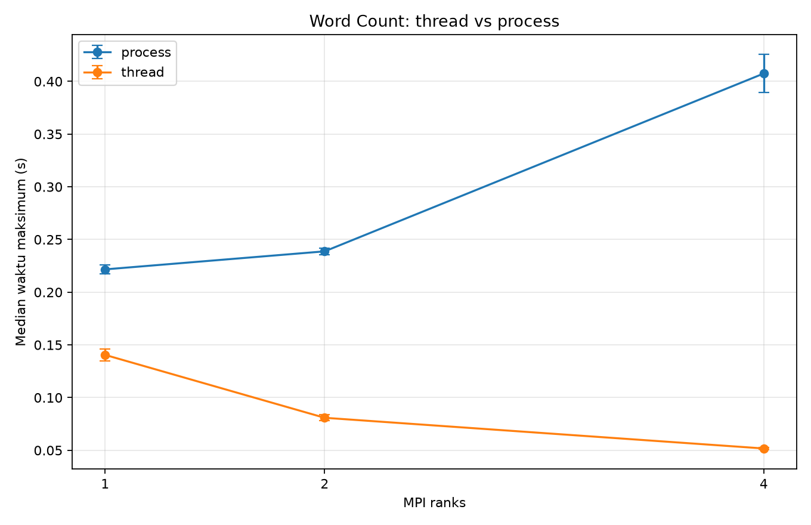

# Ringkasan Hasil Hybrid Computing

Semua angka di bawah berasal dari eksekusi yang direkam di `results/logs/`. Mesin terverifikasi di `results/sysinfo.txt`: AMD Ryzen 7 7445HS, 6 core fisik, 12 thread logis, RAM 15.23 GiB, Windows 11, Python 3.11.9, mpi4py 4.1.2, Microsoft MPI 10.1.12498.52.

## B1: Hybrid Pipeline

Temuan utama:

1. Grid menjalankan 42 konfigurasi pada dataset 160 file, dengan satu warm-up dan lima ulangan tercatat per konfigurasi.

2. Throughput median tertinggi terukur 1031.861 files/s pada loader=2, workers=1, Q_MAX=4.

3. Rata-rata throughput menurut workers turun dari 964.068 files/s pada 1 worker menjadi 414.246 files/s pada 16 workers.

4. Rata-rata throughput Q_MAX=32 adalah 744.185 files/s dan Q_MAX=4 adalah 738.919 files/s; selisih agregatnya kecil dibanding variasi antar konfigurasi.

5. Hanya 3 dari 21 pasangan loader/worker memiliki selisih median Q_MAX yang melewati satu simpangan baku gabungan berdasarkan metrik deskriptif yang digunakan.

### Tabel B1

# Analisis B1

Setiap baris merangkum median dari 5 ulangan setelah 1 warm-up. `std_throughput` adalah simpangan baku sampel throughput pada lima ulangan.

## Semua konfigurasi
| Loader | Workers | Q_MAX | Total time median (s) | Throughput median (files/s) | Avg latency median (s/file) | Std throughput (files/s) |
|---|---|---|---|---|---|---|
| 1 | 1 | 4 | 0.164189 | 974.486 | 0.00022041 | 36.987 |
| 1 | 2 | 4 | 0.166066 | 963.471 | 0.00029293 | 52.871 |
| 1 | 4 | 4 | 0.182901 | 874.791 | 0.00032292 | 13.211 |
| 1 | 6 | 4 | 0.205107 | 780.079 | 0.00034575 | 21.950 |
| 1 | 8 | 4 | 0.224785 | 711.790 | 0.00037205 | 33.568 |
| 1 | 12 | 4 | 0.290318 | 551.119 | 0.00045250 | 18.675 |
| 1 | 16 | 4 | 0.373230 | 428.690 | 0.00049692 | 20.421 |
| 2 | 1 | 4 | 0.155060 | 1031.861 | 0.00022245 | 24.411 |
| 2 | 2 | 4 | 0.163049 | 981.297 | 0.00027356 | 37.604 |
| 2 | 4 | 4 | 0.181453 | 881.773 | 0.00031872 | 21.695 |
| 2 | 6 | 4 | 0.194430 | 822.918 | 0.00034060 | 10.987 |
| 2 | 8 | 4 | 0.214667 | 745.342 | 0.00038324 | 7.513 |
| 2 | 12 | 4 | 0.478879 | 334.114 | 0.00049887 | 85.670 |
| 2 | 16 | 4 | 0.435151 | 367.688 | 0.00057341 | 9.765 |
| 4 | 1 | 4 | 0.178046 | 898.642 | 0.00025842 | 77.831 |
| 4 | 2 | 4 | 0.179396 | 891.881 | 0.00030298 | 33.178 |
| 4 | 4 | 4 | 0.195170 | 819.798 | 0.00031945 | 18.030 |
| 4 | 6 | 4 | 0.224679 | 712.129 | 0.00034929 | 63.006 |
| 4 | 8 | 4 | 0.217934 | 734.167 | 0.00033710 | 14.692 |
| 4 | 12 | 4 | 0.278162 | 575.205 | 0.00046116 | 10.202 |
| 4 | 16 | 4 | 0.366917 | 436.066 | 0.00046688 | 14.493 |
| 1 | 1 | 32 | 0.163935 | 975.997 | 0.00025098 | 35.437 |
| 1 | 2 | 32 | 0.164989 | 969.762 | 0.00028742 | 12.960 |
| 1 | 4 | 32 | 0.181039 | 883.787 | 0.00028956 | 21.682 |
| 1 | 6 | 32 | 0.201292 | 794.865 | 0.00033964 | 3.033 |
| 1 | 8 | 32 | 0.225089 | 710.831 | 0.00036693 | 9.750 |
| 1 | 12 | 32 | 0.290217 | 551.312 | 0.00041204 | 18.390 |
| 1 | 16 | 32 | 0.371529 | 430.653 | 0.00050255 | 10.607 |
| 2 | 1 | 32 | 0.157936 | 1013.068 | 0.00022477 | 38.168 |
| 2 | 2 | 32 | 0.160942 | 994.149 | 0.00028519 | 81.250 |
| 2 | 4 | 32 | 0.175632 | 910.996 | 0.00032313 | 20.409 |
| 2 | 6 | 32 | 0.196328 | 814.964 | 0.00030795 | 28.336 |
| 2 | 8 | 32 | 0.292252 | 547.473 | 0.00047107 | 58.534 |
| 2 | 12 | 32 | 0.369709 | 432.772 | 0.00048896 | 41.568 |
| 2 | 16 | 32 | 0.413082 | 387.332 | 0.00046514 | 28.179 |
| 4 | 1 | 32 | 0.179704 | 890.353 | 0.00025748 | 30.270 |
| 4 | 2 | 32 | 0.176666 | 905.664 | 0.00029682 | 12.908 |
| 4 | 4 | 32 | 0.190471 | 840.024 | 0.00031828 | 10.716 |
| 4 | 6 | 32 | 0.191108 | 837.223 | 0.00032838 | 20.514 |
| 4 | 8 | 32 | 0.213907 | 747.988 | 0.00036152 | 12.064 |
| 4 | 12 | 32 | 0.289002 | 553.629 | 0.00042116 | 30.510 |
| 4 | 16 | 32 | 0.367779 | 435.044 | 0.00046133 | 24.847 |

## Lima throughput tertinggi
| Loader | Workers | Q_MAX | Throughput (files/s) | Std throughput (files/s) |
|---|---|---|---|---|
| 2 | 1 | 4 | 1031.861 | 24.411 |
| 2 | 1 | 32 | 1013.068 | 38.168 |
| 2 | 2 | 32 | 994.149 | 81.250 |
| 2 | 2 | 4 | 981.297 | 37.604 |
| 1 | 1 | 32 | 975.997 | 35.437 |

## Rata-rata throughput per jumlah worker
| N_WORKERS | Rata-rata throughput (files/s) |
|---|---|
| 1 | 964.068 |
| 2 | 951.037 |
| 4 | 868.528 |
| 6 | 793.696 |
| 8 | 699.598 |
| 12 | 499.692 |
| 16 | 414.246 |

## Rata-rata throughput per jumlah loader
| Loader threads | Rata-rata throughput (files/s) |
|---|---|
| 1 | 757.260 |
| 2 | 733.268 |
| 4 | 734.129 |

## Rata-rata throughput per Q_MAX
| Q_MAX | Rata-rata throughput (files/s) |
|---|---|
| 4 | 738.919 |
| 32 | 744.185 |

## Selisih Q_MAX 32 dibanding 4
Perubahan persen = `(throughput Q32 - throughput Q4) / throughput Q4`. Ambang noise deskriptif dihitung sebagai `sqrt(std_Q4^2 + std_Q32^2)`; tanda Ya berarti selisih absolut median melewati satu simpangan baku gabungan, bukan uji signifikansi statistik.
| Loader | Workers | Q4 throughput | Q32 throughput | Perubahan | Noise gabungan (files/s) | Selisih > noise? |
|---|---|---|---|---|---|---|
| 1 | 1 | 974.486 | 975.997 | +0.16% | 51.223 | Tidak |
| 1 | 2 | 963.471 | 969.762 | +0.65% | 54.437 | Tidak |
| 1 | 4 | 874.791 | 883.787 | +1.03% | 25.390 | Tidak |
| 1 | 6 | 780.079 | 794.865 | +1.90% | 22.159 | Tidak |
| 1 | 8 | 711.790 | 710.831 | -0.13% | 34.956 | Tidak |
| 1 | 12 | 551.119 | 551.312 | +0.03% | 26.210 | Tidak |
| 1 | 16 | 428.690 | 430.653 | +0.46% | 23.011 | Tidak |
| 2 | 1 | 1031.861 | 1013.068 | -1.82% | 45.307 | Tidak |
| 2 | 2 | 981.297 | 994.149 | +1.31% | 89.530 | Tidak |
| 2 | 4 | 881.773 | 910.996 | +3.31% | 29.787 | Tidak |
| 2 | 6 | 822.918 | 814.964 | -0.97% | 30.391 | Tidak |
| 2 | 8 | 745.342 | 547.473 | -26.55% | 59.014 | Ya |
| 2 | 12 | 334.114 | 432.772 | +29.53% | 95.222 | Ya |
| 2 | 16 | 367.688 | 387.332 | +5.34% | 29.823 | Tidak |
| 4 | 1 | 898.642 | 890.353 | -0.92% | 83.510 | Tidak |
| 4 | 2 | 891.881 | 905.664 | +1.55% | 35.600 | Tidak |
| 4 | 4 | 819.798 | 840.024 | +2.47% | 20.974 | Tidak |
| 4 | 6 | 712.129 | 837.223 | +17.57% | 66.261 | Ya |
| 4 | 8 | 734.167 | 747.988 | +1.88% | 19.010 | Tidak |
| 4 | 12 | 575.205 | 553.629 | -3.75% | 32.171 | Tidak |
| 4 | 16 | 436.066 | 435.044 | -0.23% | 28.765 | Tidak |

## B2: MPI dan ProcessPool

Temuan utama:

1. Baseline makespan lama T1 adalah 0.382761 s; nilai ini dipakai ulang tanpa pengukuran ulang untuk membandingkan seluruh konfigurasi.

2. Makespan terendah dalam data lama adalah 0.288248 s pada ranks=2, workers=1 (n=2), dengan speedup 1.327888 dan efisiensi 0.663944.

3. Kombinasi ranks=4, workers=4 memakai n=16 dan total 20 proses (4 rank induk + 16 worker), melewati ambang fisik dan logis.

4. TOTAL_TASKS=8 membatasi paralelisme maksimum delapan tugas global meski konfigurasi menyediakan lebih banyak worker.

5. Biaya startup pool/import NumPy mungkin mendominasi makespan pada tugas kecil; ini dugaan dari bentuk beban dan bukan fakta yang diisolasi oleh pengukuran.

### Tabel B2

# Tabel B2

Metrik dihitung ulang dari makespan lama; baseline T1 = 0.382761 s (ranks=1, workers=1). Makespan tidak diukur ulang untuk tabel ini.

| Ranks | Workers/rank | n=ranks*workers | Makespan (s) | Speedup=T1/T | Efisiensi=speedup/n | Oversub fisik (n>6) | Oversub logis (n>12) | Total proses=ranks+n |
|---:|---:|---:|---:|---:|---:|:---:|:---:|---:|
| 1 | 1 | 1 | 0.382761 | 1.000000 | 1.000000 | Tidak | Tidak | 2 |
| 1 | 2 | 2 | 0.297574 | 1.286272 | 0.643136 | Tidak | Tidak | 3 |
| 1 | 4 | 4 | 0.328545 | 1.165018 | 0.291255 | Tidak | Tidak | 5 |
| 2 | 1 | 2 | 0.288248 | 1.327888 | 0.663944 | Tidak | Tidak | 4 |
| 2 | 2 | 4 | 0.316255 | 1.210292 | 0.302573 | Tidak | Tidak | 6 |
| 2 | 4 | 8 | 0.401250 | 0.953921 | 0.119240 | Ya | Tidak | 10 |
| 4 | 1 | 4 | 0.309163 | 1.238056 | 0.309514 | Tidak | Tidak | 8 |
| 4 | 2 | 8 | 0.396123 | 0.966268 | 0.120784 | Ya | Tidak | 12 |
| 4 | 4 | 16 | 0.389541 | 0.982595 | 0.061412 | Ya | Ya | 20 |

Catatan: TOTAL_TASKS=8 membatasi paralelisme tugas maksimum menjadi 8 tugas serentak. Dugaan, bukan fakta terukur: pada beban ini makespan mungkin didominasi biaya startup pool proses dan impor NumPy.

Eksekusi validasi baru `mpiexec -n 4 ... --workers 4` menghasilkan makespan 0.414518 s, 2,080,000 sampel, dan estimasi pi 3.140917. Angka ini tidak mengganti dataset makespan lama.

## B3: Word Count

Temuan utama:

1. Korpus terdiri dari 30 artikel (15 Indonesia, 15 Inggris), berukuran total 2.325818 MB dengan 340129 token regex.

2. Audit baris 78-95 menunjukkan timer mencakup pembuatan dan penutupan executor pada kedua mode; kode B3 tidak diubah karena cakupan waktunya setara.

3. Pada 1 rank, median thread 0.140518 s dan process 0.221649 s; rasio process/thread 1.577.

4. Pada 4 rank, median thread 0.051737 s sedangkan process 0.407472 s; rasio process/thread 7.876. Thread memberi hasil lebih cepat pada beban korpus ini.

5. Top-10 4-rank thread dan process identik; enam stopword wajib tidak muncul. Runner juga memverifikasi kesamaan Top-10 untuk 1, 2, dan 4 rank.

### Inventaris korpus

Output per file dan total token ada di [corpus_info.txt](corpus_info.txt); sumber dan URL ada di [corpus_sources.md](corpus_sources.md).

### Audit kode

Detail timer, penjelasan waktu, dan STOPWORDS ada di [b3_audit.md](b3_audit.md).

### Tabel B3

# Tabel B3

Median dan std dihitung dari lima pengulangan setelah satu warm-up. Speedup memakai baseline 1 rank untuk mode yang sama. Rasio process/thread adalah median process dibagi median thread; nilai di atas 1 berarti process lebih lambat.

| Mode | MPI ranks | Workers/rank | Median waktu maks (s) | Std (s) | Speedup vs 1 rank mode sama | Rasio process/thread |
|:---|---:|---:|---:|---:|---:|---:|
| process | 1 | 4 | 0.221649 | 0.004168 | 1.000 | 1.577 |
| thread | 1 | 4 | 0.140518 | 0.005777 | 1.000 | 1.577 |
| process | 2 | 4 | 0.238755 | 0.003166 | 0.928 | 2.953 |
| thread | 2 | 4 | 0.080853 | 0.002803 | 1.738 | 2.953 |
| process | 4 | 4 | 0.407472 | 0.018096 | 0.544 | 7.876 |
| thread | 4 | 4 | 0.051737 | 0.000884 | 2.716 | 7.876 |

### Eksperimen korpus besar opsional

Salinan 30 file, masing-masing minimal 1 MB, berukuran total 31.169549 MB. Lima ulangan setelah warm-up; worker/rank=4.

| Mode | Ranks | Median (s) | Std (s) | Rasio process/thread |

|:---|---:|---:|---:|---:|

| process | 1 | 0.641463 | 0.035852 | 0.444 |

| thread | 1 | 1.444396 | 0.130220 | 0.444 |

| process | 2 | 0.580329 | 0.023268 | 0.812 |

| thread | 2 | 0.714748 | 0.057010 | 0.812 |

| process | 4 | 0.742018 | 0.035950 | 1.545 |

| thread | 4 | 0.480252 | 0.021401 | 1.545 |

Pada 1 dan 2 rank, process lebih cepat (rasio < 1); pada 4 rank thread lebih cepat. Hasil ini berlaku untuk salinan korpus dan mesin yang diuji, bukan aturan umum.

## Keterbatasan

- B1 memakai lima ulangan per konfigurasi; variasi sistem, cache filesystem, dan proses latar dapat memengaruhi hasil singkat.

- B2 tabel utama memakai makespan lama yang tidak diukur ulang dan tidak menyediakan distribusi ulangan untuk menghitung noise. Satu eksekusi baru hanya berfungsi sebagai validasi program.

- Beban B1 berisi file kecil. Benchmark utama B3 memakai korpus asli sekitar 2.33 MB; eksperimen tambahan memakai pengulangan konten untuk membesarkan file, bukan dokumen besar yang independen dan bervariasi.

- Hasil korpus besar tidak boleh digeneralisasi ke dokumen nyata lain karena setiap file dibentuk dengan mengulang teks sumber sampai minimal 1 MB.

- B3 memakai lima ulangan per konfigurasi; waktu sangat singkat pada mode thread sensitif terhadap noise timer dan aktivitas OS.

- Ambang noise Q_MAX adalah pemeriksaan deskriptif 1 simpangan baku gabungan, bukan uji hipotesis atau interval kepercayaan.

- Dugaan dominasi startup pada B2 belum diuji dengan baseline tanpa pool atau variasi ukuran task.

