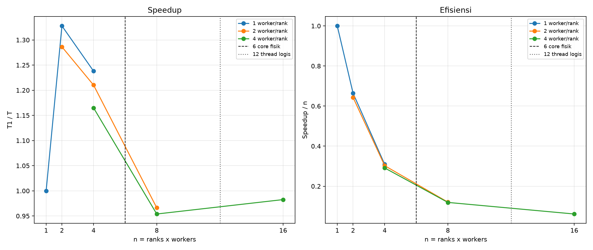

# Tabel B2

Metrik dihitung ulang dari makespan lama; baseline T1 = 0.382761 s (ranks=1, workers=1). Makespan tidak diukur ulang untuk tabel ini.

| Ranks | Workers/rank | n=ranks*workers | Makespan (s) | Speedup=T1/T | Efisiensi=speedup/n | Oversub fisik (n>6) | Oversub logis (n>12) | Total proses=ranks+n |
|---:|---:|---:|---:|---:|---:|:---:|:---:|---:|
| 1 | 1 | 1 | 0.382761 | 1.000000 | 1.000000 | Tidak | Tidak | 2 |
| 1 | 2 | 2 | 0.297574 | 1.286272 | 0.643136 | Tidak | Tidak | 3 |
| 1 | 4 | 4 | 0.328545 | 1.165018 | 0.291255 | Tidak | Tidak | 5 |
| 2 | 1 | 2 | 0.288248 | 1.327888 | 0.663944 | Tidak | Tidak | 4 |
| 2 | 2 | 4 | 0.316255 | 1.210292 | 0.302573 | Tidak | Tidak | 6 |
| 2 | 4 | 8 | 0.401250 | 0.953921 | 0.119240 | Ya | Tidak | 10 |
| 4 | 1 | 4 | 0.309163 | 1.238056 | 0.309514 | Tidak | Tidak | 8 |
| 4 | 2 | 8 | 0.396123 | 0.966268 | 0.120784 | Ya | Tidak | 12 |
| 4 | 4 | 16 | 0.389541 | 0.982595 | 0.061412 | Ya | Ya | 20 |

Catatan: TOTAL_TASKS=8 membatasi paralelisme tugas maksimum menjadi 8 tugas serentak. Dugaan, bukan fakta terukur: pada beban ini makespan mungkin didominasi biaya startup pool proses dan impor NumPy.

